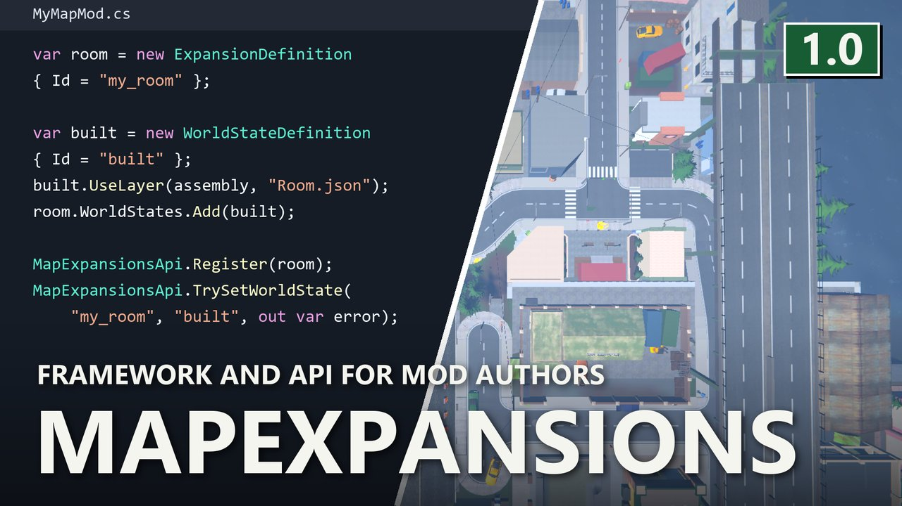

# MapExpansions

> 🛟 **Need help or found a bug?** Get support at [support.doodesch.de/mapexpansions](https://support.doodesch.de/mapexpansions).

📖 **API documentation:** [docs.doodesch.de/mods/mapexpansions/api/](https://docs.doodesch.de/mods/mapexpansions/api/)

 

> Framework and API for mods that add map areas and property upgrades. Another mod brings the content, MapExpansions builds it into the world.

## For players

Install it when a mod asks for it, like [Based](https://thunderstore.io/c/schedule-i/p/DooDesch/Based/). On its own it adds nothing you can see.

In co-op, every player needs it and the same version of the mods that use it.

## For mod authors

Register an `ExpansionDefinition` in `OnInitializeMelon`:

- **New areas:** terrain from a source scene, connections to the main world, regions and a sheet on the phone map.
- **Life in the area:** NPC and vehicle navigation, buildings, parking lots, deal locations, shops and a police station.
- **Properties:** copy a property to a new place, or extend an existing one with new floor, grids and docks.
- **World states:** named states you switch at runtime and take back, for upgrades that build up over time.
- **Edits:** hide, cut or copy main-world objects, in code or from a JSON layer.

Declare the dependency with `[assembly: MelonAdditionalDependencies("MapExpansions")]` and add `DooDesch-MapExpansions-1.0.0` to your `manifest.json`. Reference the DLL, do not copy the code.

## Requirements

- [MelonLoader](https://melonwiki.xyz/) 0.7.3 or newer

## Community

Join the DooDesch Mods Discord: update pings, polls on what comes next, and playtests of new mods.

## License

DooDesch API License, see [LICENSE.md](LICENSE.md). Build your own mods against the API. Forks, changes and pull requests are welcome. Publishing or reuploading the mod or a changed copy needs written permission.

This mod is written with help from generative AI tools (Anthropic Claude, OpenAI Codex).

If you have fun with it, a like on the [Thunderstore page](https://thunderstore.io/c/schedule-i/p/DooDesch/MapExpansions/) really helps other people find it (thumbs up next to Download, you need to be logged in) - ty either way, and lemme know if anything breaks or you've got ideas
